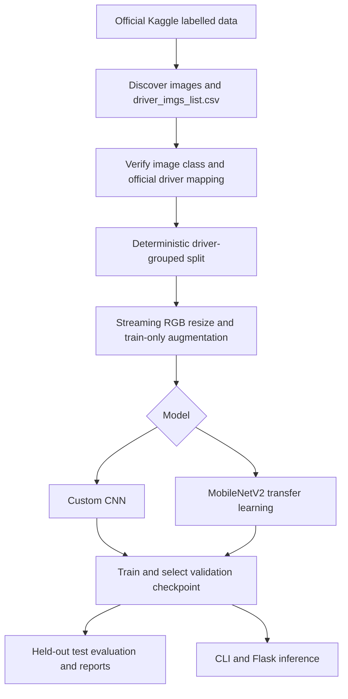
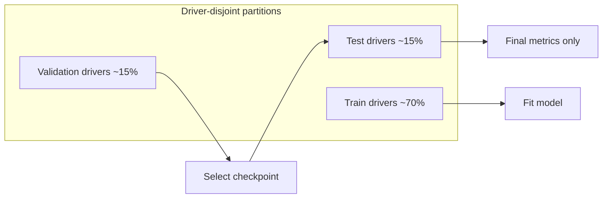

# Distracted Driver Detection

A resource-conscious, PyTorch-based computer-vision project for classifying the State Farm Kaggle competition's 10 in-car driver-behavior classes. It includes two model families, verified metadata-to-driver mapping, driver-isolated train/validation/test partitions, evaluation tooling, tests, and an optional Flask dashboard.

> **Research/demo only.** Predictions are experimental and must not be relied upon for driving safety or real-time driver monitoring. No dataset or trained model is included in this repository.

## Problem and objectives

Classify a labeled driver-camera image as one of the ten official State Farm competition classes. The project prioritizes reproducible splits, auditable evaluation, CPU-capable streaming input, and a usable demonstration interface. It does not claim to detect unsafe driving in live vehicles.

## Official class mapping

The code and competition metadata use the codes as labels; descriptions below are the official competition class names:

| Code | Official class description |
|---|---|
| c0 | Safe driving |
| c1 | Texting with right hand |
| c2 | Talking on phone with right hand |
| c3 | Texting with left hand |
| c4 | Talking on phone with left hand |
| c5 | Operating the radio |
| c6 | Drinking |
| c7 | Reaching behind |
| c8 | Hair and makeup |
| c9 | Talking to passenger |

## Architecture and workflow





The splitting unit is the driver, not the photograph. This avoids near-duplicate views of the same person appearing in both training and evaluation, which would otherwise create identity leakage and optimistic estimates of performance on unseen drivers. The implementation uses fixed-seed `GroupShuffleSplit`; the requested image-independent driver proportions are approximate because drivers have unequal image counts. The split command validates zero overlap and saves CSV manifests and actual per-class counts.

## Environment and current workspace audit

Initial implementation audit (Windows 11, Python 3.10.10): 16 GB RAM reported, about 3.3 GB free at inspection, about 307 GB disk free; Intel Iris Xe integrated graphics; PyTorch 2.0.1+cpu and NumPy 1.26.4 available; CUDA unavailable. The workspace was empty. No dataset archive or `driver_imgs_list.csv` was found in the checked Desktop/Downloads locations. TensorFlow is intentionally not installed; PyTorch is the primary framework. Pytest and torchvision were absent initially, then installed in `.venv` and verified.

## Setup

Use a local virtual environment. In PowerShell from the project directory:

```powershell
py -3.10 -m venv .venv
.\.venv\Scripts\Activate.ps1
python -m pip install --upgrade pip
```

For this inspected workstation, create the environment with `py -3.10 -m venv --system-site-packages .venv` instead, so the audited CPU PyTorch and scientific libraries can be reused. Activate it as above. Then install the project requirements (which pin the audited CPU-only PyTorch wheels):

```powershell
python -m pip install -r requirements.txt
```

For a clean environment without shared system packages, install the matching CPU PyTorch pair first, then the remaining requirements:

```powershell
python -m pip install torch==2.0.1+cpu torchvision==0.15.2+cpu --extra-index-url https://download.pytorch.org/whl/cpu
python -m pip install -r requirements.txt
```

For a compatible NVIDIA system, select a matching CUDA-enabled `torch`/`torchvision` pair from <https://pytorch.org/get-started/locally/> and adjust/remove the CPU-only requirement pins before installing the rest of `requirements.txt`.

The workstation's existing Python installation already contained CPU PyTorch and core numerical/image libraries; this setup uses `.venv` and does not alter the global environment. Do not install TensorFlow alongside PyTorch for this project.

## Get the dataset

1. Sign in to Kaggle, open the [State Farm competition](https://www.kaggle.com/c/state-farm-distracted-driver-detection), and accept its competition rules.
2. Download the competition files from Kaggle. The pipeline needs the labeled training images and `driver_imgs_list.csv`. The official competition's separate test images are unlabeled and are not used for labeled evaluation.
3. Either extract the downloaded archive under `data/raw/`, preserving folders containing `c0` ... `c9` and `driver_imgs_list.csv`, or configure the Kaggle CLI credentials as described in Kaggle's official API documentation. Never commit `kaggle.json` or credentials. Credentials belong in the OS user's `.kaggle` folder.
4. Optional Kaggle CLI download (only after accepting the rules and configuring credentials):

```powershell
python prepare_data.py --data-dir data/raw --download
```

Manual-download option:

```powershell
python prepare_data.py --data-dir data/raw
```

The script discovers common nested extracted layouts, checks every discovered JPEG, verifies class-folder/metadata consistency, maps image filenames to the official `subject` driver IDs, and stops if required metadata is absent, ambiguous, inconsistent, or incomplete. Dataset access may require multiple Kaggle archives; extract all competition archives below `data/raw/` before preparation. Do not use the unlabeled official competition test set as a labeled test split.

### Reproducible splits

`prepare_data.py` requests 70/15/15 proportions across distinct drivers with seed 48. Due to a finite, discrete set of drivers and unequal per-driver image counts, actual proportions can differ; inspect printed driver/image/class counts in `data/processed/dataset_stats.json`. The generated files are `data/splits/train.csv`, `validation.csv`, `test.csv`, and `manifest.csv`. Each driver is assigned to precisely one partition, which the tests enforce. Any absent class in a particular split is retained as zero-support in reports rather than fabricated.

## Models and training

- `custom_cnn`: four convolutional blocks, batch normalization, ReLU, max pooling, spatial dropout, global average pooling, and 10 logits.
- `mobilenetv2`: torchvision MobileNetV2 with a 10-class head. Use `--pretrained` to request ImageNet weights. ImageNet weights require compatible `torchvision` and may require network access. On a download or compatibility error, install a matching PyTorch/torchvision pair, or omit `--pretrained` to initialize without external weights.
- Both accept RGB images scaled to [-1, 1] and use sparse integer labels with cross entropy. Training augmentation is restricted to small rotations and mild brightness changes; batch size defaults to 8, image size to 160, and loader workers to 0 for modest RAM/CPU usage.
- The CNN is the recommended first smoke check. CPU training can take a long time; smoke-test before full training. No run is reported as trained unless it actually finishes.

Examples:

```powershell
python train.py --model custom_cnn --smoke-test
python train.py --model custom_cnn --epochs 15 --batch-size 8 --image-size 160
python train.py --model mobilenetv2 --epochs 10 --batch-size 8 --pretrained
python train.py --model mobilenetv2 --epochs 10 --batch-size 4 --fine-tune
```

Supported options are `--model {custom_cnn,mobilenetv2}`, `--epochs`, `--batch-size`, `--image-size`, `--workers`, `--cpu-threads`, `--learning-rate`, `--early-stopping-patience`, `--smoke-test`, `--pretrained`, `--fine-tune`, `--resume`, and `--manifest`. CPU thread count defaults to two, and long runs report progress every 100 batches.

Pretrained loading is opt-in. If pretrained weights cannot be fetched the model warns and falls back to random initialization, which is not transfer learning; the random backbone remains trainable. Use `--fine-tune` to unfreeze the final feature blocks when starting from pretrained weights. A smoke test processes only a few batches, saves files with a `_smoke` suffix, and never creates/replaces the deployable model. Full-training best checkpoints are saved under `models/checkpoints/`; the web/CLI inference checkpoint is `models/final/best_model.pt`. Epoch history is under `outputs/reports/`. Resumption restores model and optimizer state from a project checkpoint. A stopped run does not automatically become a completed full training result.

## Evaluation

Select the model/checkpoint using training/validation only, then evaluate once on the held-out test drivers:

```powershell
python evaluate.py --model-path models/checkpoints/custom_cnn_best.pt --model custom_cnn
```

The evaluator outputs test loss, accuracy, macro precision/recall/F1, per-class classification report, confusion matrix, test split statistics, parameter count, checkpoint file bytes, and mean forward-pass latency on the chosen device. Charts and reports go to `outputs/figures/` and `outputs/reports/`. Never tune hyperparameters or select checkpoints against the test split. If a model or dataset is missing, evaluation exits with an actionable error rather than inventing results.

### Measured baseline (2026-10-23)

The included checkpoint is a deliberately short custom-CNN baseline: one epoch, 64×64 inputs, batch 16, CPU (2 threads). Training accuracy was 51.99%; validation accuracy was 61.73%. A single evaluation on the held-out four-driver test split (3,768 images) measured **67.89% accuracy**, **65.86% macro F1**, and **0.8993 test loss**. Mean batched forward latency was 6.38 ms/image on CPU. Class results vary substantially (for example c3 F1 0.9208 versus c8 F1 0.2510); this model is not converged or validated for safety use. Full per-class results, plots, and setup are in the generated reports. The held-out test set was not used for tuning.

## Web application and inference

```powershell
python app.py
```

Visit <http://127.0.0.1:5000>. With the included trained checkpoint, the dashboard reports the model as ready and supports image prediction. Without a checkpoint, it shows model-unavailable status and disables inference. It accepts JPEG/PNG, validates image contents and a configurable 8 MB limit, uses secure display filenames, and does not persist upload bytes. The health endpoint is `/health`; metrics are served from `/metrics`. Recent predictions are stored in a signed browser session and can be cleared. Configure `MODEL_PATH`, `MODEL_NAME`, `HOST`, `PORT`, and a deployment-specific `FLASK_SECRET_KEY` through environment variables (see `.env.example`; the app does not automatically load `.env`). A random process-local secret is generated for development if none is configured; set a stable secret in production. Never expose Flask's development server publicly.

Single-image CLI:

```powershell
python predict.py --image path/to/driver_image.jpg
```

For production on a Unix-like deployment with Gunicorn installed:

```sh
gunicorn --workers 2 --bind 0.0.0.0:8000 app:app
```

On Windows, use the included Waitress dependency:

```powershell
waitress-serve --listen=0.0.0.0:8000 app:app
```

Configure TLS, reverse proxy, access limits, and secret management in deployment.

## Tests and checks

```powershell
python -m pytest -q
python -m compileall .
```

Tests use generated images and temporary synthetic metadata; the complete Kaggle corpus and trained model are not needed. Transfer-learning initialization requires an installed compatible torchvision and is therefore an environment-dependent check.

## Outputs and technical report

- `models/checkpoints/`: selected training checkpoints.
- `models/final/`: dashboard/CLI inference checkpoint.
- `outputs/figures/`: training curves, confusion matrix, class F1 chart.
- `outputs/reports/project_report.md`: technical report with the measured one-epoch baseline and held-out results.
- `outputs/reports/environment_report.md`: initial machine and dependency audit.

## Limitations and future work

The State Farm dataset is curated and may not represent different cameras, vehicles, lighting, populations, or real driving conditions. Driver-disjoint evaluation improves leakage control but does not establish real-world safety. Class imbalance and driver-group constraints can leave some classes poorly represented in one partition. CPU-only training and lack of preinstalled torchvision/pretrained weights limit the first run. Future work may include verified subject-level cross-validation, calibration, external-domain evaluation, privacy review, model monitoring, and carefully validated temporal/video models. No reference list or literature claims are included without independently verified bibliographic records; the technical report marks literature review as pending.

## Troubleshooting

- **Metadata missing:** extract the competition's labeled training archive including `driver_imgs_list.csv` below `data/raw/`.
- **Kaggle download rejected:** accept competition rules on Kaggle, install/configure the official Kaggle CLI, and retry; alternatively download manually.
- **Image/file mismatch:** restore the official directory layout and avoid renaming images/classes.
- **MobileNet torchvision error:** install the matching `torch`/`torchvision` versions; use the custom CNN while arranging the dependency.
- **Pretrained weights unavailable:** remove `--pretrained`; this initializes the backbone randomly and is not transfer learning.
- **No model in the dashboard:** train to generate `models/final/best_model.pt`, or set `MODEL_PATH` to a compatible checkpoint.
- **CPU is slow:** start with `--smoke-test`, reduce image size or batch size, and use the custom CNN for pipeline verification.
